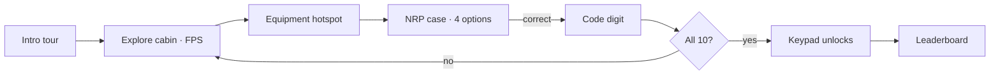

<div align="center">


<p>
  <a href="https://neo-resus-escape-2-0.vercel.app"></a>
  
  
  
</p>

<p><em>A web-based 3D first-person escape room that tests medical students on Neonatal Resuscitation Program scenarios.<br>
You are locked inside an ambulance; every correct answer reveals one digit of the door code.</em></p>

</div>


## How it plays

Explore the cabin and inspect ten pieces of medical equipment. Each one opens a clinical case with four options and a hint video. Answer correctly and a digit of the door code appears; collect them all and the keypad unlocks. Instead of a static exam, students practise clinical decisions under time pressure, inside a cinematic space, with a leaderboard for friendly competition.

| | |
|---|---|
| **3D ambulance** | A procedurally built cabin with PBR materials. |
| **10 NRP cases** | Scenario, four choices, a hint video and a code digit for each. |
| **Coded door** | Correct answers collect digits; the keypad opens when the code is complete. |
| **Cinematic intro** | A camera tour, typewriter storytelling and a halfway celebration. |
| **Procedural sound** | A Web Audio engine with no audio files. |
| **Mobile controls** | A virtual joystick on the left and an action button on the right. |
| **Leaderboard** | Persistent local scores with CSV export. |
| **Post-processing** | Bloom, vignette, chromatic aberration and flickering ceiling LEDs. |




## Türkçe özet

**NeoRescue (Kilitli Ambulans)**, tıp öğrencilerini bir ambulansın içinde yenidoğan resüsitasyonu (NRP) senaryolarıyla sınayan web tabanlı bir 3B FPS kaçış odası oyunu. Oyuncu kabindeki 10 tıbbi ekipmanı inceleyip klinik soruları yanıtlıyor; her doğru cevap kapı şifresinin bir rakamını açıyor. Sinematik açılış, dosyasız prosedürel ses, mobil joystick desteği ve sıralama tablosu var.


## Development

```sh
npm install
npm run dev      # http://localhost:3000
npm run build
```

<div align="center">
<br>
<a href="https://github.com/kutluhangil"></a>
<sub>For training only · not a substitute for certified NRP instruction.</sub>
</div>
