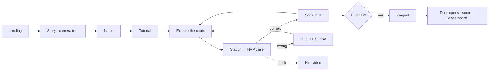

<div align="center">



<p>
  <a href="https://neo-resus-escape-2-0.vercel.app"></a>
  
  
  
</p>

<p><em>A 3D first-person escape room for medical students: locked in an ambulance, you solve<br>
ten neonatal resuscitation (NRP) cases, one per piece of equipment, to collect the door code.</em></p>

</div>


## The idea

Neonatal resuscitation is learned from algorithms and flowcharts, then needed in a cramped vehicle under pressure. NeoRescue (*Kilitli Ambulans*, the locked ambulance) puts the questions where they belong: inside the cabin, attached to the equipment you would actually reach for, with a clock running. Answer a case correctly and the device gives you a digit; ten digits open the door.

> **A score that rewards calm, not guessing.** Each solved case is worth 100 points, the clock adds a time bonus of up to 1,000 that shrinks by 2 points a second, and every wrong answer costs 30. Speed helps, but careless clicking does not pay.


## How it plays

| | |
|---|---|
| **Story and name** | A cinematic camera tour and a typewriter intro, then you enter your name for the leaderboard. |
| **Tutorial** | How to move, look and interact, on desktop or phone. |
| **Explore** | First-person movement in a procedurally built cabin with PBR materials and flickering ceiling LEDs. |
| **Ten stations** | Transport incubator, suction, BVM mask, pulse oximeter, defibrillator, APGAR timer, medicine cabinet, umbilical catheter, laryngoscope and the emergency bag. |
| **Cases** | Each station opens a clinical scenario with four options (in Turkish); right answers show feedback and a code digit, wrong ones explain why. |
| **Hint videos** | Every case has a hint video slot (`/videos/hints/case-NN-hint.mp4`); the clips are added separately. |
| **The door** | Enter the collected code on the keypad and watch the door open. |
| **Leaderboard** | Scores persist in the browser and can be exported as CSV. |
| **Sound** | A procedural Web Audio engine: no audio files. |
| **Mobile** | A virtual joystick on the left, an action button on the right. |
| **Post-processing** | Bloom, vignette and chromatic aberration. |


## Game flow



| Score part | Value |
|---|---|
| Solved case | +100 each |
| Time bonus | 1,000 − 2 × seconds, never below 0 |
| Wrong answer | −30 each |


## Türkçe özet

**NeoRescue (Kilitli Ambulans)**, tıp öğrencilerini bir ambulansın içinde yenidoğan resüsitasyonu (NRP) senaryolarıyla sınayan 3B birinci şahıs kaçış odası oyunu. Kabindeki on ekipmanın (transport inkübatörü, aspiratör, BVM, pulse oksimetre, defibrilatör, APGAR saati, ilaç dolabı, umbilikal kateter, laringoskop, acil çanta) her biri bir klinik vaka açıyor; doğru cevap kapı şifresinin bir rakamını veriyor. Puan doğru sayısı, süre bonusu ve hata cezasıyla hesaplanıyor. Sinematik açılış, dosyasız prosedürel ses, mobil joystick ve CSV dışa aktarılabilen sıralama tablosu var.


## Development

```sh
npm install
npm run dev      # http://localhost:3000
npm run build
npm run lint
```

No environment variables are needed. Put the hint clips in `public/videos/hints/` with the names used in `lib/data/questions.ts`.

```
app/                     the single page
components/three/        ambulance, equipment, lighting, player, interaction, effects, audio
components/ui/           landing, HUD, question cards, door keypad, leaderboard, mobile controls
lib/data/                questions (10 NRP cases), story text, hotspot positions
lib/store/               game state (phases, score) and the persisted leaderboard
lib/hooks/               procedural audio
NEORESCUE_MASTER_BLUEPRINT.md  the design document
```

<div align="center">
<br>
<a href="https://github.com/kutluhangil"></a>
<sub>MIT licensed · an educational game, not clinical guidance · the case text in the banner is paraphrased and the cabin is drawn.</sub>
</div>
